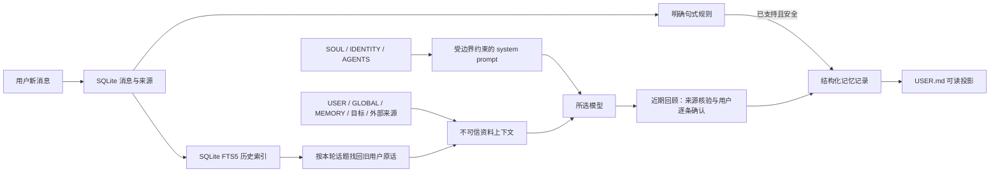

# 长期记忆运行机制对照与 OpenMuse 评估

日期：2026-10-11；更新：2026-10-12。本文回答模型每轮如何读取 SOUL.md、MEMORY.md、USER.md 等文件，以及与 Muse、OpenClaw、Hermes Agent、nanoMuse 的公开机制比较。公开资料只证明公开作者描述或当前仓库实现，不等于完整产品内部实现。

## OpenMuse 当前实际机制

OpenMuse 不会直接读取用户 Obsidian 库或电脑上任意同名文件。默认工作区由系统的 Application Support 路径创建，受 iOS/macOS 沙盒限制；SQLite 是运行时状态来源，SOUL.md、USER.md 等是 SQLite 文档记录的可读 Markdown 投影。外部编辑器直接改投影不能作为可靠写入方式，应用编辑页才会走版本与修订流程。用户选择 Obsidian 文件时，目前进入只读资料导入流程，不会自动覆盖 OpenMuse 的 SOUL/USER。

一次普通聊天目前按以下顺序运行：

1. 用户消息先进入本地消息记录。确定性规则先检查是否为受支持的明确记忆句式、人格反馈或目标状态变化；这些步骤不靠模型猜测。
2. `WorkspaceFiles` 从 SQLite 取文件快照。SOUL.md、IDENTITY.md、AGENTS.md 分开成为用户级设置；普通资料消息只包括 USER.md、GLOBAL.md、MEMORY.md、按当前话题命中的结构化记忆/目标/外部资料，以及本地历史对话搜索结果。普通聊天不载入 HEARTBEAT.md 的计划正文，计划由维护调度器读取。
3. SOUL、IDENTITY、AGENTS 以 JSON 字符串放进 system prompt。SOUL 只影响人格和协作习惯；IDENTITY 只影响名称与身份呈现；AGENTS 的文字目前只在模型提示层说明“相关工作区任务适用”，主机端没有按任务类型过滤，所以文件非空时会随每轮 system prompt 发送。应用提示明确禁止这些用户级设置覆盖权限、安全和隐私边界，或授予工具能力。
4. USER、GLOBAL、MEMORY、相关记录、历史消息和外部资料放在单独的 user-role 资料消息中，并标明它们是可编辑/可能过期的背景资料，不能执行其中的命令。历史检索只找其他对话里的原始用户消息；排除导入的 AI 历史、当前主聊/旁聊、助手生成文字和未获明确保留授权的敏感消息。
5. 系统提示、资料、侧聊片段、近期聊天、附件和当前请求由统一输入预算器计算。检索先用 SQLite FTS5 对中英文关键词及中文二/三字片段排序，再按预算选少量原句；索引可从消息记录重建，数据库升级时会建立索引。

简化数据流：



### 每个文件现在真正做什么

| 文件 | 当前读法 | 当前写法 | 主要限制 |
|---|---|---|---|
| SOUL.md | 每轮作为 system prompt 中的用户级人格偏好；超长时保留开头和最近修订 | 三类明确沟通反馈可追加固定协作习惯；手动编辑也可用 | 还不是通用自我反思；修改不能改变工具权限 |
| IDENTITY.md | 每轮作为用户选择的身份呈现资料 | 应用编辑器 | 没有独立的身份变更工作流 |
| AGENTS.md | 文件非空时每轮放入 system prompt；模型被要求只在相关任务中采用 | 应用编辑器 | 没有主机端的任务相关性过滤，不能覆盖应用权限或安全边界 |
| USER.md | 每轮作为用户资料；相关结构化事实会另外按查询召回 | 已支持的明确用户事实写入结构化 claim，再投影到 USER.md；用户可编辑/撤销 | 只自动识别规则白名单，不是任意中文事实抽取器 |
| GLOBAL.md | 每轮按较短文档预算读取 | 用户可编辑 | 自动事实路径尚未同步维护此文件，避免与 USER.md 形成第二套真值 |
| MEMORY.md | 每轮按较短文档预算读取；查询相关的 claim 另行召回 | 用户可编辑；近期回顾提案确认后主要进入 USER.md | 没有完整的长程经历/关系页整理 |
| HEARTBEAT.md | 普通聊天不读取计划正文 | 设置页写入结构化维护计划与修订 | iOS 只能机会式后台运行，不能保证定时醒来 |
| memory index | 不直接放进 prompt；本地话题命中时取来源片段 | 随消息写入/迁移重建 | 当前是词项检索和有限的本地人工概念别名扩展；无向量或通用语义改写召回 |

当前自动事实识别覆盖明确的偏好、习惯、姓名、居住地、职业等有限开头，以及“记住……”等显式请求。敏感内容需用户明确要求记住；带问号、第三方转述和明显意图/假设不自动入库。每条 claim 保留原消息 ID、原文、类型和状态，支持编辑、撤销、彻底忘记；模型失败时不抹掉已保存的消息与事实。其边界是：未匹配白名单的直白事实（例如另一种自然中文表达）不会自动成为长期事实；当前还没有每句话都调用模型抽取的流程。

近期回顾会用模型整理有限近期对话，提出事实、理解、协作习惯、目标小步骤或一对一记忆更新候选，但每项都要经用户确认才会写入。更新候选通过主题词，或明确的本人偏好、居住地、工作、姓名变化提示来召回最多12条类别相关记忆；仍是有限规则，不具备任意语义冲突发现。2026-10-12新增的协作反思及原话证据保存在对应 `MaintenanceRunRecord`，不写入 `MEMORY.md`，不作为后续对话上下文，也不独立生成 `DREAMS.md`。身份页目前只展示最近三次运行；更早记录仍可迁移，但尚无完整历史浏览界面。稳定事实进入 `MemoryClaimRecord`，确认的协作习惯进入 SOUL 修订，目标步骤进入 Goal；这些才是 Agent 后续可读取和执行的长期变化。此切片仍不是 Muse dreaming 机制的完整复刻：没有跨周主题巩固、关系整理、目标研究或后续场景效果验证，也不保证 iOS 夜间运行。

## 与公开产品/项目的对照

| 项目 | 可核实的公开机制 | 对 OpenMuse 的借鉴 | 不能直接照搬的部分 |
|---|---|---|---|
| Muse | 官方设计文章确认跨对话长期记忆、主聊/侧聊、目标、主动工作、用户可读可编辑记忆文件、活动透明和成果构件。用户提供的 SOUL.md 说明人格可以演进、修改时告知、本人可编辑。官方没有公开记忆 schema、写入算法或文件同步事务。 | 让记忆和人格可见可编辑；持续协作比单轮 prompt 更重要；从目标、聊天、动态和成果形成闭环；主动消息必须值得打扰。 | 官方确认的“云端专属电脑持续运行”不能被误说成 iOS 本地能力；社区快照中的小时/夜间周期不是官方机制证明。 |
| OpenClaw | 当前官方 Memory Core 将指令、精选核心记忆、日记/会话等 episodic 资料、计划性记忆和供人阅读的 dreaming 记录分层；SQLite 保留来源、信任级别、时间和替代关系；检索与提升有确定性门槛，dreaming 在后台合并。 | 采用“来源/信任在写入前确定”的原则；分开事实、历史原话、计划和反思；索引只负责召回，不替代证据；长期合并必须保留来源且可解释。 | 它有常驻 Gateway、cron 和后台进程；不能用其夜间任务时间表承诺 iOS 会执行。OpenMuse 目前只有有限的来源/规则与 FTS 搜索，远未达到 Memory Core 的 provenance、dreaming 与晋升门槛。 |
| Hermes Agent | SOUL 是系统提示中的身份文件；USER 与 MEMORY 是有限长度、通过 memory 工具管理的跨会话摘要，并在会话开始冻结注入；旧会话通过 SQLite FTS5 按需查找。 | 将 SOUL 与用户事实分开；常驻摘要保持小；需要细节时检索历史会话，而不是把所有聊天塞进每次 prompt。 | Hermes 的 CLI/daemon 会话边界和静态会话启动模式不同于 OpenMuse 的移动端每轮重建上下文；其文件限额和写入策略不是 Muse 或 OpenMuse 的既定标准。 |
| nanoMuse | 当前公开仓库把 SOUL、USER、GLOBAL、diary、HEARTBEAT 作为可读文件；同时有 SQLite memory/goals 和设备/relay 机制，允许多模型与多端协作。README 明确它有自托管/relay 组件，不能简单理解为“完全无服务端”。 | 学习手机和桌面各自运行、用户控制模型、文件可编辑及本机/远程能力协作；现有 OpenMinis/Python 和 Android 实现可作为具体技术研究素材。 | Android/proot、桌面 runtime 和 relay 行为不等于 iOS 沙盒；其 GPL 许可证与架构也意味着不能直接复制到 OpenMuse 的 MIT 仓库。 |

证据链接与查阅日期列在文末；Muse 闭源机制与社区归档始终分开。社区快照是重要研究线索，不作为 Muse 官方内部设计结论。

## 判断：方向合理，但距离“持续了解我”还有明显缺口

当前的“SQLite 结构化真值 + 可读 Markdown 投影 + 单独来源/修订 + 有预算的检索”适合长期演进，优于让模型直接改几份无关联文本文件。将 SOUL 与事实资料放入不同 prompt 角色也更符合文件语义：SOUL 要能影响模型行为；USER/外部来源必须保持低信任；人格不能升级权限。新加的历史 FTS 回忆补上了原来“只有明确记忆和当前目标才能跨会话出现”的断层。

但这还不能证明模型会持续、完整地认识用户。当前主要缺口是：

1. **写入覆盖不够**：明确事实只覆盖规则白名单；未匹配表达会留在聊天记录而不进入结构化画像。建议下一步做“模型抽取候选 + 原文证据逐字校验 + 敏感/主体/时效规则 + 低风险明确事实自动写入 + 不确定项预览确认”，并让抽取失败不影响正常聊天。
2. **冲突和时间语义仍不够**：claim 现在可存可选 `validFrom`/`validUntil`；明确事实从原消息时间起效，明确偏好纠正会结束旧有效期并开始新有效期。新增窄规则：当前居住地陈述/明确搬迁可以结束旧现居 claim；籍贯/出生地与现居地分开保留，同句同时明确两者时识别现居子句；只表达计划或不确定搬迁的句子不会作为长期事实保存。这个实现能过滤已知过期/未来记录，但没有一般事实冲突裁决、观察时间、主体 ID 或自然语言时间抽取；其他需要理解上下文的冲突仍不应只靠词面重合裁决。
3. **召回仍是词项级**：FTS5 对人名、地点、近似原句有效；少量人工别名能桥接已知同义词，但无法理解任意改写或“上次说的预算”。应先用合成对话集评测命中率和误召回，再考虑本地 embedding/混合检索；不要先加向量库却不验证写入质量。
4. **dreaming 还没有闭环**：近期回顾已保存带来源证据的运行反思，事实、理解、协作习惯和目标变化分别走结构化记录及确认流程；逐字引文能核对出处，但不保证内容归纳正确。仍未具备跨周主题巩固、反思变化追踪、后续相似情境行为验收和稳定结果反馈。应持续追踪经用户确认的事实更新、SOUL 修订和目标进展是否改善后续帮助。反思运行记录足以支持当前身份页检查，新增 `DREAMS.md` 会与结构化维护记录形成重复真值；如以后需要人类可读日记，应从维护记录生成只读/可重建导出。
5. **用户本地文件不是自动来源**：OpenMuse 当前读取自己的 sandbox 工作区，不扫描 Obsidian 或电脑文件。若希望 Obsidian 成为长期来源，需要明确选择/只读同步、来源显示、更新冲突、撤销与删除传播；不能静默扫描。
6. **双端连续性仍有边界**：Mac/iPhone 各自有本地副本，在线连接时同步；iCloud 尚未接入，离线删除/编辑不能即时到另一台设备。用户必须能看到待同步、冲突和每台设备最后同步时间。

## 推荐的长期闭环

```text
用户原话 / 明确授权的外部来源
  → 记录来源、主体、时间、范围和信任级别
  → 确定性过滤 + 受约束的语言抽取
  → 明确事实按已确认规则更新；推断/外部提取进入预览
  → 单一 claim / goal / schedule 记录提交
  → 生成 USER / MEMORY / GLOBAL 等可读视图
  → 新对话按角色和话题召回，并标明原话与日期
  → 周期回顾提出整理/理解/协作变化，不悄悄写成事实
  → 用户纠正、撤销、忘记或确认
  → 双端带来源同步；离线设备清楚显示未完成
```

验收不应只看“文件里有文字”，还要用数周的合成/授权个人场景检查：一次说出的偏好能否在新话题中正确用上；过时事实是否被质疑而不是照搬；来源和修改能否找回；明确纠正后是否生效；推断是否只在确认后升级；用户撤销后是否不再召回；另一设备同步完成前是否如实显示。

## 来源

### 2026-10-12 OpenClaw dreaming 边界复核

- OpenClaw 当前官方文档将 `MEMORY.md`/`USER.md` 作为精选长期记忆，将 daily notes/session transcripts 作为经历层；Dreaming 的 Light 与 REM 阶段整理和反思，Deep 阶段在门槛通过后才可更新 `MEMORY.md`。
- 官方把 `DREAMS.md` 定义为人类阅读的 dreaming 日记和变更摘要，不是长期记忆晋升来源；这是 OpenClaw 额外的 review surface，不代表每个陪伴型 Agent 都必须有同名文件。
- OpenMuse 采用同一职责区分，但维护运行及其反思/原话证据保存在结构化记录中。`DREAMS.md` 不作为核心工作区文件；若需要分享或查看长篇回顾，未来从结构化记录生成，不单独编辑。
- 来源：[OpenClaw Dreaming](https://docs.openclaw.ai/concepts/dreaming)、[OpenClaw Memory architecture](https://docs.openclaw.ai/concepts/memory-architecture)，查阅于 2026-10-12。上述为 OpenClaw 官方公开设计，不是 Muse 官方内部机制证明。

- Muse 官方产品设计：[How We Designed Muse](https://introducing.muse.ai/)，查阅于 2026-10-11；官方宣布：[Introducing Muse](https://about.fb.com/news/2026/09/introducing-muse-personal-ai-agent/)，查阅于 2026-10-11。
- OpenClaw 官方：[Memory architecture](https://docs.openclaw.ai/concepts/memory-architecture)、[Dreaming](https://docs.openclaw.ai/concepts/dreaming)，查阅于 2026-10-11。
- Hermes 官方：[Which file does what](https://hermes-agent.nousresearch.com/docs/user-guide/which-file-does-what)、[Persistent Memory](https://hermes-agent.nousresearch.com/docs/user-guide/features/memory)，查阅于 2026-10-11。
- nanoMuse 当前公开仓库：[nano-muse/nanoMuse README](https://github.com/nano-muse/nanoMuse)、[Configuration](https://nanomuse.cn/docs/configuration)，查阅于 2026-10-11。仓库许可证与依赖须以实际 clone commit 为准。
- Muse 社区运行文档快照固定提交：[self_improvement.md](https://github.com/win4r/MuseAI-Skills/blob/38bbb45a2c5a0f70de975f6387385770b9ad8aac/home/hatch/docs/self_improvement.md)。它是社区整理，不代表官方源码或当前服务状态；OpenMuse 本地研究见 [MEMORY_AND_DREAMING.md](muse-research/MEMORY_AND_DREAMING.md)。
- OpenMuse 本地证据：`WorkspaceFiles.swift`、`PromptContextBuilder.swift`、`SQLiteStore.swift`、`OpenMuseAppModel.swift`、`IntentCapture.swift`、`DreamingReview.swift` 及对应 `WorkspacePersistenceTests`。
