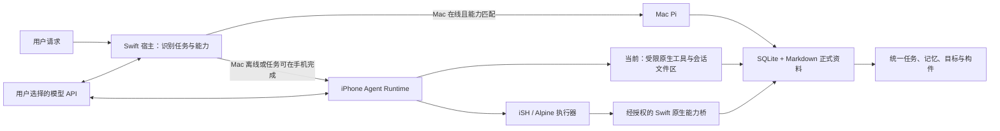

# iPhone 端侧 Agent Runtime 设计

日期：2026-10-11。范围：调整 iPhone 的运行方式；不改变 OpenMuse 的产品目标、Muse 式交互、Mac Pi 优先原则、模型供应商选择或记忆规则。

## 当前实现状态（2026-10-11）

### 最新状态：T68 Build 4 真机部署与浏览器动作验收

- iPhone 15 Pro Max / iOS 27.2 已安装并启动 `org.openmuse.ios` 0.1.0 Build 4。Core 236 项中234项通过、2项因缺少实时 Tailscale/Pi 地址条件跳过、0失败；iOS Simulator Debug 与 iPhone ARM64 Debug 构建均通过。
- 真机 DeepSeek 对话在同一 `tab_id=1` 的 `quotes.toscrape.com` 页面验证 `get_backbone`、`scroll_and_collect`、`hover`：结构树返回 `div.quote` 的引用/作者/链接层级；采集返回10条，`scrollPosition=126`、`scrollSteps=1`、`totalItemsSeen=20`；结果未提供截断字段，因此只确认这10条被返回，不声称整个站点已全量采集；悬停命中第一条作者链接且未点击或跳转。
- `IOSPhoneBrowserRuntime` 已修正 `callAsyncJavaScript`：包装函数显式返回异步采集结果，非结构化/空返回现在报错，不再静默变成 `{}`。本次对照运行显式等待 DOM 稳定，未单独隔离“等待稳定”和“显式返回”各自对旧空结果的贡献。手动签名时还需单独签 `OpenMuse.debug.dylib` 和 `__preview.dylib`；签名、安装及 PUA 前台确认均通过。日志与本机安装包见 [T68](ITERATIONS.md)。
- Mac Tailscale 运行正常但没有在线移动设备，真实 iPhone→Mac Pi 接管仍未验；guest 超时/强制终止恢复、锁屏后台、Cookie/localStorage 跨重启等仍未验。

### 最新状态：默认浏览器、持久标签与 iSH 共用（D40/D41/T61/T62）

- iPhone Agent 默认可调用一个通用 `openmuse_phone_browser_use` 工具；只有用户明确要求离线或不要浏览时才隐藏。对话标签使用固定 390×844 视口、系统持久 `WKWebsiteDataStore`，URL 元数据本机保存并惰性恢复；站点 Cookie/localStorage 跨重启由实现提供，但尚未单独实测。URL 恢复不重建原 DOM、滚动位置或表单状态。
- 真机完成 `navigate → get_readable` 和后续 `list_tabs → get_readable`，复用同一 `tab_id=1`；明确 URL 导航失败会停止本轮，不允许模型冒报成功。一次天气工具流程实际尝试 Google 后回退到 Bing，故当前网络下 Google 成功仍未验。
- 真机又验证模型 `browser_use` 与 iSH guest 的 `openmuse-browser-use` 共享对话标签池：模型导航出 `tab_id=1` 后，iSH `list_tabs` 和 `get_readable --tab-id 1` 读回同一 Example Domain 页面；调用详情保留两条命令和完整输出。
- 浏览器操作保存在既有活动详情。详情现默认全高，执行进度与操作时间线共同滚动；真机展开浏览器操作后可查看工具名、调用编号、设备、查询参数和真实返回。操作日志截图仅存本机 iPhone-use 产物区，没有加入仓库。
- OpenMinis 对照后修正的相邻路由问题：浏览器默认可用而非按消息意图猜测；`browser_use` 不再因包含 `browse` 被误判为搜索；明确不执行 iSH 时不强制 shell；搜索与打开链接使用各自的强制动作，工具失败关闭。公开 HTTPS 浏览免逐次审批，iSH guest 网络按 D37 不另加逐次审批。细节见 [T58](ITERATIONS.md) 和 [专项研究](OPENMINIS_BROWSER_PERMISSIONS_2026-10-11.md)。
- 验证：全量 Core 测试 235 项执行、233 通过、2 项条件跳过；T58 的 33 项定向 Core 测试与活动详情 iOS UI 测试 1/1 通过；iPhone 15 Pro Max / iOS 27.2 签名版安装、签名校验、启动及浏览器活动详情真机检查通过。覆盖安装后 iSH 重新读取 tab 1 的保存 URL 成功。T68 Build 4 已在真实网页逐项验证 `get_backbone`、`scroll_and_collect`、`hover`，结果边界见上节。T67 已验证 guest DNS 查询和 HTTPS GET；超时取消/崩溃恢复、锁屏续跑、Cookie/localStorage 跨重启等仍未验。

### T63/T67：按 OpenMinis 上游实现并真机验证 guest DNS

- 源码复核：固定 OpenMinis 提交 `b4c0661d5631ebab4d1a2e6f3fd4c805d4030a6c` 的 `ISHKernel.configureDns()` 用 `res_ninit` / `res_getservers` 读取 iOS 当前 nameserver，写入 guest `/etc/resolv.conf`；`NetworkMonitor` 用 `NWPathMonitor` 在网络路径变化时刷新。上游 iOS target 显式链接 `libresolv.tbd`。见[上游 DNS 实现](https://github.com/OpenMinis/OpenMinis/blob/b4c0661d5631ebab4d1a2e6f3fd4c805d4030a6c/src/ios/iSH/ISHKernel.m)、[网络监视器](https://github.com/OpenMinis/OpenMinis/blob/b4c0661d5631ebab4d1a2e6f3fd4c805d4030a6c/src/ios/Shared/NetworkMonitor.swift)与[链接依赖](https://github.com/OpenMinis/OpenMinis/blob/b4c0661d5631ebab4d1a2e6f3fd4c805d4030a6c/src/ios/Minis.xcodeproj/project.pbxproj)。
- 修正：移除 OpenMuse 自建的 `getaddrinfo` DNS 合成代理及 iSH socket 改写补丁；现在把系统 resolver 地址原样写给 guest，并在每次 guest 执行前及 iOS 网络路径更新时刷新。早先记录的“resolver 符号不可链接”根因是 OpenMuse target 缺少 `libresolv` 链接，并非上游机制不可用；本轮补上 iOS `-lresolv`。
- 失败基线（T63）：iPhone 15 Pro Max 上 `uname -a` 与 Alpine 版本读取成功；旧 guest 的 `nslookup example.com` 返回 `198.18.0.45`，但 `wget https://example.com/` 报 `bad address`；绕过 DNS 直连公开 IP 在45秒内超时。这是旧 DNS 代理与当时网络路径不匹配的证据。
- T63 当时的签名阻塞已由 T66 手动签名解决：`OpenMuse-T66-iphone-signed-v2.app`（0.1.0 Build 3）通过签名校验并安装到 iPhone 15 Pro Max / iOS 27.2；该版本包含本节的 resolver 修正。
- 真机结果（T67）：guest `/etc/resolv.conf` 显示 `nameserver 198.18.0.2`；`nslookup example.com` 经该 resolver 返回 `198.18.0.45`；`wget -S -O /dev/null --timeout=15 https://example.com/` 收到 `HTTP/1.1 200 OK`，Cloudflare 响应，下载577字节，退出码为0。完整命令、调用 ID、设备、输出和超时标记见 [T67](ITERATIONS.md)。
- 解释边界：`198.18.0.0/15` 是 IANA 特殊用途注册表中的 Benchmarking 网段，不是全球可达的公网地址。HTTPS 成功证明 iSH guest 经当前 resolver/设备网络路径可完成请求；不能据此声称真实公网 DNS 解析或绕过 VPN、代理、合成地址转换层。其他网络下的直连对照仍待验，不应擅自修改当前 DNS/VPN。参考 [IANA IPv4 Special-Purpose Registry](https://www.iana.org/assignments/iana-ipv4-special-registry)。
- 构建：T63 的 iOS arm64 unsigned Debug 与 Simulator Debug 日志仍保留在 `.build/logs/openmuse-ish-network-device-build.log` 和 `.build/logs/openmuse-ish-network-simulator-build.log`；T66 的签名、安装证据见 `.build/logs/openmuse-t66-device-install-verify.log`。超时取消/崩溃恢复、锁屏后台、只读记忆/skills 投影、native offload、rootfs 升级、自动双端工作区同步及 Cookie/localStorage 跨重启仍未验。

### 历史验收补记：iPhone 本机网页查询与审批边界（T54，已由 D40/T61 更新）

- 修复无 Mac 时 iPhone 查询天气却声称没有联网工具的问题。根因是初始本机 runtime 无浏览器，只能误走 iSH；在增加浏览器工具后，基础 system prompt 仍说当前没有网页能力，与运行时提示冲突。本轮已统一提示，并按请求意图仅给模型开放本轮可用能力。
- iPhone 现有原生隔离只读搜索与 HTTPS 页面正文读取。天气、实时信息、明确联网或用户给出 URL 时开放；明确要求离线时不开放。只发送必要公开搜索词，不登录、不填写/提交表单、不修改页面；无需逐次审批。
- T54 历史权限状态：当时 iSH 命令仍要求首用审批；该门槛后来由用户在 D37 明确取消。当前普通 guest command/network 不逐条审批，正式记忆和资料写入仍按宿主确认规则处理。
- 真机 DeepSeek 查询广州天气已由 iPhone 本机浏览器完成，给出百度搜索页摘要和来源链接，没有调用 iSH；页面天气值本次未独立交叉核验。Core 定向测试26/26通过，iOS Simulator Debug 与真机签名构建、安装、启动通过。详见 [T54](ITERATIONS.md)。
- OpenMinis 的分级审批与小型工具胶囊对照见 [专项研究](OPENMINIS_BROWSER_PERMISSIONS_2026-10-11.md)。OpenMuse 暂继续使用 Muse 头像和活动详情作为任务入口，不在短查询下叠加胶囊；较长、多步骤网页任务再评估。

### 历史验收补记：DeepSeek 工具调用与审批卡（T53，逐条审批已由 D37 取消）

- 用户已在 iPhone 设置中保存 DeepSeek API key，且已启用本机工具。具体凭证未读取或记录。
- 首次真实调用时，模型在 `tool_choice:auto` 下返回文字执行结果，但活动详情没有 iSH 工具事件，审批页也没有待处理项。该输出没有执行证据，不能视为 shell 已运行；先前误称执行成功的说法已更正。
- 现已修正为：用户明确要求 shell 时只提供 iSH 工具并要求命名工具调用。工具不可用、模型只返回文字或返回错误工具名时，宿主拒绝当作执行并失败关闭。系统提示要求只有拿到工具结果后才能声称执行成功。
- T53 当时的真实 DeepSeek 回合在 iPhone 显示包含完整 `uname -a && cat /etc/alpine-release` 命令的正式审批卡，按钮为“拒绝”和“允许本次执行”。这是当时权限实现的记录；用户后来以 D37 明确要求普通 iSH 命令和出站网络不再逐条审批。
- `PhoneAgentRuntimeTests` 10 项通过；Core 全量216项中214项通过、2项因缺少实时 Pi/Tailscale endpoint 跳过、0失败。签名 iPhone Debug 包构建、签名校验、覆盖安装通过。证据见 [T53](ITERATIONS.md) 与本机忽略目录 `.research-local/openmuse-device/2026-10-11/INDEX.md`。

- 用户已按 D32 确认 GNU GPL-3.0 与 iSH 集成。固定 `OpenMinis/ish-arm64` commit `e6521d9cfe9cd48f19917fc3b23aea622ba358b4`，以及 Alpine 3.24.2 aarch64 rootfs，均已进入 iOS 真机构建流程；打包 rootfs 约 9.9 MB。
- iPhone 版集成 Swift 宿主与 iSH/Alpine guest：普通命令和出站网络按 D37 不逐条审批；命令最多 4 KB、45 秒、输出最多 12 KB。只挂当前对话运行目录，附件只读；guest 与 App 共进程，不是强隔离 VM。
- T52 曾因 resolver 符号链接失败而加入回环 DNS 代理；T63 已移除代理与 iSH socket patch，改用 OpenMinis 同样的系统 resolver 列表写入 guest，并在 guest 命令开始和 `NWPathMonitor` 路径变化时刷新，iOS target 补 `-lresolv`。T66 签名 Build 3 已包含该修正，并由 T67 在真机完成 DNS 与 HTTPS GET 验收。
- 历史安装与工具调用证据见 [T52/T53](ITERATIONS.md)；持久浏览器和共享标签已在 [T58/T62](ITERATIONS.md) 真机验证。T64 新增的结构树、滚动采集和悬停已随 Build 4 在真机网页逐项验收；锁屏持续执行、rootfs 自动升级、共享记忆/skills guest 投影、完整原生 offload 和自动双端工作区同步仍未完成。

以下方案段落保留了研究过程；若其中旧段落仍写着“尚未集成 iSH”或“保留 MIT”，以本节与 D32/T52 为准。

## 结论

OpenMinis 的 iOS 端不是“在手机上运行大模型”。它通过网络调用用户选择的模型，同时在 App 内嵌入 iSH 的 Alpine Linux 运行环境，让 agent 可以执行命令、处理隔离工作区文件，并通过原生桥接调用 iOS 能力。Android 使用 PRoot；不能把 Android 方案直接当成 iOS 实现。上游在 2026-09-29 的 `b4c0661d5631ebab4d1a2e6f3fd4c805d4030a6c` 快照中说明两种平台差异、构建步骤和许可证。[OpenMinis README](https://github.com/OpenMinis/OpenMinis/blob/b4c0661d5631ebab4d1a2e6f3fd4c805d4030a6c/README.md)、[BUILDING.md](https://github.com/OpenMinis/OpenMinis/blob/b4c0661d5631ebab4d1a2e6f3fd4c805d4030a6c/BUILDING.md)

OpenMuse 手机模型仍通过用户选择的 API 推理；Swift 宿主管理工具调用、权限、检查点和活动。iPhone 版已集成 iSH/Alpine guest shell，以及默认提供给 Agent 的本机持久只读浏览器；对话工作区、附件访问、输出上限和正式写回仍由既有 Swift 宿主规则管理。附件内容始终作为不可信资料，工作区草稿仍不属于长期记忆、双端同步数据或正式构件。按 D37，iSH 普通执行和 guest 出站网络不逐次审批；正式资料写入与敏感 iOS 数据仍按类别授权。T67 已验证 guest DNS 查询和 HTTPS GET；超时取消、进程崩溃恢复和锁屏后台续跑仍未验证。

## 持久手机浏览器（D39 / D40 / D41 / T58 / T62）

参照 OpenMinis 固定提交的 `browser_use` → session `BrowserTabPool` → per-tab `BrowserUseManager` 结构，iPhone 现在由模型调用单个通用 `openmuse_phone_browser_use` 工具。支持 `search`、`navigate`、`get_readable`、`get_text`、`get_page_info`、`find_elements`、`click`、`type`、`scroll`、`wait_for_dom_stable`、`new_tab`、`close_tab`、`list_tabs`；同一对话可重复操作同一 `tab_id`。对话最多3个标签，全局最多8个活动 WKWebView；每次动作在目标标签互斥执行。Google 搜索会在当前标签导航，并按设置读取备用引擎；实时天气类请求的首个模型工具 schema 会把 `action` 限定为 `search`，工具真实失败时不再给模型机会编造来源。

**D39 历史基线（存储与工具暴露已被 D40 修正）**：标签 URL、标题和选中 ID 写入本机 UserDefaults，供后续恢复 WebView 时按需重新加载；当时的实现使用进程内非持久 WebKit data store，并按当前消息意图开放浏览器。这些是旧状态，不代表当前实现。顶层页面仍只允许公开 HTTPS；允许安全 HTTPS 子框架、`about:blank`/`srcdoc` 和公开 HTTPS 创建的 `blob:` 子框架。超过15分钟空闲的 WebView 释放，保存的 URL 保留；达到全局上限时淘汰最近最久未用的空闲 WebView，无法找到空闲标签时返回上限错误。导航超时30秒；导航后以500毫秒间隔等待最多5秒 DOM 稳定后再提取正文。

**D40 当前实现修正**：与上游一致，WKWebView 有 390×844 的移动布局视口，并使用 `WKWebsiteDataStore.default()` 持久保存本机站点数据；这替代上文 D39 记录的进程内非持久 store。标签 URL/标题/所选 ID 仍按对话本机保存并在下次需要时惰性加载。Cookie 与网站 localStorage 因系统默认 store 可留在同一设备跨重启；OpenMuse 工具不读取或写入 Cookie，也不会把网站数据或 URL 同步给 Mac/iCloud。重载页面不会恢复当时 DOM、滚动位置或未提交表单。默认向手机 Agent 提供通用 browser_use 能力，用户明确要求离线/不要浏览时才隐藏；打开明确链接时强制调用 navigate，失败直接作为真实失败返回。正文抽取先读取 article/main，再以清除 script/style 后的 textContent 兜底，并返回不含正文的安全诊断字段帮助区分空页和网页加载错误。

**D41 iSH 共用标签池**：iOS App 将同一 `IOSPhoneBrowserRuntime` 同时注入手机 Agent 和 `ISHPhoneSandboxRuntime`。每条 guest shell 调用携带当前 conversation ID；`openmuse-browser-use` 通过 vendored iSH native offload handler 将结构化动作回送 Swift runtime，继续操作同一个 WKWebView/tab ID。真机导航、`list_tabs`、`get_readable` 及活动操作详情已验，见 [T62](ITERATIONS.md)。当前只开放相同安全动作集；它没有复制 OpenMinis 的截图回传、Cookie、任意 JS、下载能力。

为符合 D34 的风险边界，普通公开浏览免逐次审批；浏览器不提供任意 JavaScript、Cookie 读取/写入、文件下载、截图图像回传、视口/UA 控制或无限滚动收集。点击会拦截可识别的表单提交与高影响标签，输入拒绝密码/一次性验证码字段。该识别不能判定每个站点链接的 GET 请求是否有副作用，模型提示词不能当作网络隔离；用户仍可在活动详情逐次查看模型动作、参数、标签、页面来源、结果/错误与时间。上游完整工具范围和差异见 [OpenMinis 浏览器权限对照](OPENMINIS_BROWSER_PERMISSIONS_2026-10-11.md)，实际验证以 [T58](ITERATIONS.md) 记录为准。

OpenMuse 的端侧系统按职责分层：Swift 宿主管模型回合、权限、任务/检查点和原生能力；iSH/Alpine 提供 iPhone guest shell；本机对话工作区保存可恢复的中间材料；SQLite 与 Markdown 继续作为目标、记忆和正式成果的唯一事实来源。iSH 不替代产品层存储，也不会自动获得任意 iOS 权限。

## OpenMinis 的手机运行系统

1. **Agent loop**：模型可返回多个 function/tool calls；宿主校验工具清单、运行工具、把每个工具结果作为 tool 消息发回模型，再继续一轮。工具运行过程进入消息和任务状态。
2. **iSH 沙箱**：iOS 通过定制 iSH 内核运行 Alpine aarch64 用户空间，不是 Android 的 PRoot。App 将会话附件、工作区、浏览器/输出目录挂载到隔离路径；共享 memory 与 skills 有单独位置。
3. **原生 offload**：部分 Linux 命令由 iSH 内核拦截，再转给 Objective-C/Swift handler 调用 iOS 框架。工具可用性因此同时取决于模型、iSH 命令、原生权限和系统状态。
4. **持久状态**：聊天/会话和长期记忆存于 App 管理的存储；沙箱文件系统为执行提供工作目录，不应替代产品层事实来源。
5. **后台**：OpenMinis 另外管理系统后台额度、增强后台选项、定位、静音音频、播放/媒体中断、Live Activity 和通知。iOS 不给普通 App 无限后台进程。上游代码只能证明它实现了这些状态管理，不能证明每台设备都持续运行、用户强制退出后会重启或适合 OpenMuse 的审核策略。[BackgroundKeepAliveManager.swift](https://github.com/OpenMinis/OpenMinis/blob/b4c0661d5631ebab4d1a2e6f3fd4c805d4030a6c/src/ios/Agent/Background/BackgroundKeepAliveManager.swift)、[ISHExecutionCoordinator.swift](https://github.com/OpenMinis/OpenMinis/blob/b4c0661d5631ebab4d1a2e6f3fd4c805d4030a6c/src/ios/Agent/ISH/ISHExecutionCoordinator.swift)、[iOS sandbox summary](https://github.com/OpenMinis/OpenMinis/blob/b4c0661d5631ebab4d1a2e6f3fd4c805d4030a6c/docs/specs/ios-sandbox-ish-summary.md)

## 与 OpenMuse 整体 PRD 的匹配

| OpenMuse 要求 | 端侧运行时责任 |
|---|---|
| 用户持续使用同一陪伴者，记忆可迁移 | SQLite 是结构化事实源；SOUL/USER/GLOBAL/MEMORY/HEARTBEAT 仍由 WorkspaceFiles 投影和版本控制。运行目录只放临时输入和工具输出。 |
| 模型可更换 | tool schema 走 OpenAI-compatible function calling；模型不拥有工具实现。供应商不支持工具调用时要明确报能力不兼容，并允许无工具聊天。 |
| 手机独立可用，Mac 在线优先 Pi | 手机 Agent Runtime 本机执行获准能力；跨设备路由只在 capability contract 允许时交给 Mac Pi。iSH 不运行 Mac Pi，也不访问 Mac 文件。 |
| Mac 断开后手机接手可执行任务 | 先恢复结构化 task/checkpoint，再由 iPhone 工具执行器接续；尚无对应工具或权限时显示等待/不可用，不假装完成。 |
| 敏感动作须授权、记忆来源可追溯 | 模型只能请求明确列出的工具。工具宿主校验参数、权限、范围、输出大小和任务状态；有副作用的工具独立审批与记账。 |
| 长期主动工作和 dreaming | BackgroundTasks 只作机会式触发；定时提醒由通知系统呈现。后台执行状态和锁屏任务唤醒必须真机实测，不能用 iSH 常驻误当作 iOS daemon。 |
| 日常使用和资料迁移 | 迁移导出包含 SQLite 记录、修订、可读 Markdown、附件和构件；不导出缓存的 Alpine rootfs 或模型密钥。 |

## OpenMuse 实施方案

模型推理仍使用用户配置的 API；运行位置变化不改变人格、任务、记忆和成果的数据合同。真机 shell/DNS 尚待有效模型配置后端到端验收。

### OpenMinis 机制与 OpenMuse 当前实现对照

| 机制 | OpenMinis iOS | OpenMuse 当前落地 | 尚缺能力 |
|---|---|---|---|
| Agent loop | 模型多轮调用工具；宿主执行、回传结果并继续 | 有界 OpenAI-compatible tool loop，最多 6 轮；工具参数、输出、取消和状态受宿主控制 | DeepSeek 真正 tool-call 回合与真机执行未验 |
| 端侧执行环境 | iSH fork 运行 Alpine aarch64，支持进程、shell、文件与网络 | 固定 fork/rootfs 已集成 iPhone 版本；普通命令与 guest 网络不逐次审批（D37），仍有限时和输出上限；DNS 已改为系统 resolver nameserver + 网络路径刷新，unsigned iOS arm64 构建通过 | 新 DNS 实现的签名安装/HTTPS 真机验收、资源压力、终止恢复、自动 rootfs 升级和 App Store 分发待验 |
| 会话文件 | 附件、workspace、浏览器、offload 分开；每会话目录持久存在 | guest 挂载按对话隔离；workspace/offloads/browser 可写、attachments 只读；正式工作区仍由 Swift 宿主审批 | guest 只读记忆/技能投影、浏览器/offload 宿主能力和自动双端目录同步 |
| 共享记忆/技能 | memory 与 skills 单独挂载 | 记忆、目标、历史和核心 Markdown 通过只读宿主工具从正式结构化数据读取 | skills 目录和 iSH 只读投影；正式写入仍须走 schema/权限校验 |
| 原生 offload | guest 命令映射至 Swift/Objective-C handler | 目前只暴露明确列出的本机只读能力与临时文件工具 | 日历、通知、分享、浏览器等每项单独授权的宿主桥及审计 |
| 后台 | 单独管理系统后台时间、媒体/音频/定位状态、Live Activity 与通知 | 依赖系统机会式后台任务、通知与已保存检查点 | 锁屏长任务、系统回收和真机电量/恢复验收；不承诺常驻 |

OpenMinis 将 per-session 文件区与共享 memory/skills 分层；OpenMuse 再增加一条产品约束：SQLite 与 Markdown 是正式状态唯一来源，运行时文件是本机工作材料，不自动成为用户事实或共享成果。这个差异是刻意设计，避免执行环境和正式记忆各自保留一份“用户状态”。

### 宿主与数据边界

- Swift 宿主负责模型请求、function/tool loop、任务取消、能力授权、活动展示、结构化存储、同步、构件校验和错误恢复。
- `ModelToolDefinition` 是每次请求的能力白名单。模型返回的工具名和 JSON 参数都视为不可信输入；未登记工具不会调用执行器。
- SQLite 与 Markdown 是产品资料唯一正式来源。当前原生工作区位于 Application Support，按对话隔离，单文件最多 256 KB、最多 80 个/16 MB，仅允许 md/txt/json/csv；iOS 文件使用首次解锁后保护。它不自动双端同步；用户明确导出且选择包含聊天时，工作区草稿会进入校验过的迁移包。iSH 只挂载每对话 `AgentRuntimeSessions/{conversation-hash}` 下的 workspace/offloads/browser/attachments；禁止挂整个 App Container、Keychain、数据库文件、正式 Agent 工作区或任意用户目录。
- 只读查询输出可以进入本轮模型上下文，也会在 D38 的独立工具详情记录中以限长、凭证脱敏形式保留；活动摘要与 task checkpoint 不复制正文。任何正式资料写回仍先经过 Swift 宿主的 schema 校验和用户权限政策，再以原子事务保存 SQLite/文档版本。
- 外部资料、网页、邮件和工具 stdout 都是低信任内容；不能覆盖 system prompt、SOUL/权限规则，也不能直接升级成 USER.md 事实。

### 执行路径

1. 发送前创建或复用本机 execution-task，记录模型、工具能力、输入修订和 owner。
2. 如果已配对 Mac 在线且具备该任务所需能力，按当前执行协议交给 Mac Pi；Mac 专属任务在 Mac 不可达时为 `waiting_device`。
3. 手机独立或接手时使用 iPhone Agent Runtime。当前可调用本机历史/目标读取、受限核心文件读取、本对话附件只读提取，以及当前对话持久工作区的文件操作；活动保存受限、脱敏的逐次操作详情，task checkpoint 仍只保存摘要和引用。工作区不自动双端同步；包含聊天的用户迁移包可显式带上草稿。草稿仍不属于长期记忆或正式成果，正式旅行计划须另存为构件。
4. iPhone 的 `sandbox-shell` 能力由模型按任务选择；普通 iSH 命令和 guest 出站网络不逐次审批（D37）。原生日历/通知/文件选择等仍需独立 Swift offload，不把 shell 映射成这些系统权限。
5. 取消、后台时限、内存压力或进程终止时，先提交最后已确认 checkpoint；重启后从 SQLite/任务状态恢复，不依赖 Linux 子进程仍存活。
6. 结果经过确定性校验后写回 Goal/Artifact/Memory 等现有结构；聊天生成文本本身不代表旅行完成或外部动作成功。

手机 Agent 默认提供与 iSH 共用的对话级持久浏览器标签。除导航、读取、点击、输入、单步滚动和 tab 管理外，T64 又增加页面结构树、连续滚动采集与悬停；模型和 `openmuse-browser-use` 使用同一参数与执行器。T68 已在 Build 4 真机网页验收这三项动作；采集返回10条，但未返回截断标记。截图回传、下载、Cookie 和任意 JS 仍未接入；不能将当前浏览器标为与 OpenMinis 全量一致。

### 后台策略

首版不使用静音音频或持续定位来伪造常驻任务。这些能力只有在真实产品功能确实需要音频播放或位置追踪时才可单独评估。已开始的前台任务使用 iOS 提供的有限后台机会并保存检查点；新计划任务用系统通知提醒，模型推理可在系统授予的后台刷新或用户下次打开时运行。UI 必须区分“正在运行”“等待系统”“已暂停”“等待 Mac”“失败”。

## iSH 集成与许可证（D32 已确认）

用户已确认 OpenMuse 原创代码采用 GNU GPL-3.0，并集成固定 iSH fork。iSH 的 `LICENSE.md`、`LICENSE.IOS` 与 Alpine 包 notices 保留并随 iOS/Mac App 打包。历史 T52 曾将本地 DNS socket patch 单独保存在 `Vendor/patches`；T63 已移除该 patch，改用 OpenMinis 源码中的系统 resolver 配置。上游 iOS 权利说明不替代对组合发行、各依赖许可证和 Apple 分发条件的复核。[OpenMinis README](https://raw.githubusercontent.com/OpenMinis/OpenMinis/b4c0661d5631ebab4d1a2e6f3fd4c805d4030a6c/README.md)、[iSH LICENSE.md](https://github.com/OpenMinis/ish-arm64/blob/e6521d9cfe9cd48f19917fc3b23aea622ba358b4/LICENSE.md)、[iSH LICENSE.IOS](https://github.com/OpenMinis/ish-arm64/blob/e6521d9cfe9cd48f19917fc3b23aea622ba358b4/LICENSE.IOS)、[GPL-3.0 文本](https://raw.githubusercontent.com/OpenMinis/OpenMinis/b4c0661d5631ebab4d1a2e6f3fd4c805d4030a6c/LICENSE)

构建脚本在本机 `.build` 中用固定版本 Meson/Ninja 构建 iSH ARM64 静态库和 Alpine 3.24.2 minirootfs；T68 签名 Build 4 已在 iPhone 安装，包含 T63 resolver 修正；T67 已验证当前系统 resolver 下的 DNS 与 HTTPS GET。`198.18.0.45` 是保留地址，不能当作直连公网 DNS 结果。仍需测试 guest 运行隔离、其他网络下 DNS/HTTPS、rootfs 更新及分发条件。

当前能力边界：rootfs 首次复制到 Application Support 后会持久化，不自动升级；guest 与宿主共进程，不是独立 VM；普通命令和出站网络不逐条审批（D37），但仍受 4 KB/45 秒/12 KB 输出上限约束。正式记忆、数据库、Keychain 和任意用户文件不挂载；guest 工作区只限当前对话草稿，附件只读。锁屏运行不保证。OpenMuse 采用 GPL-3.0；第三方许可证和分发条件仍需核对。T67 已证明 guest 在当前网络路径完成 HTTPS GET，但尚未验证超时取消、强制终止后的恢复和其他网络环境。

## 验收关卡

| 关卡 | 证据 |
|---|---|
| 手机 agent tool loop | 合成 OpenAI-compatible 服务返回 tool call；iPhone 本机执行器运行；结果回传模型并生成回复；工具事件顺序、usage 汇总、取消、未知工具拒绝、轮数和大小上限有测试。 |
| iSH 建置与隔离 | 固定 commit 可重建 device arm64 依赖和 rootfs；首启、升级迁移、App 重启恢复、越界路径、symlink、网络访问、写入、进程超时和 kill 经测试。 |
| 任务接管 | Mac 在线由 Pi 处理；Mac 离线由手机执行手机支持步骤；Mac 专属步骤等待；检查点、epoch、防重复提交在双端测试。 |
| 后台 | 真机区分前台长任务、锁屏已开始任务、新到期计划、系统回收和强制退出；采集系统版本/权限/网络/电量证据。测试前不得承诺常驻。 |
| 长期资料 | 工具执行/恢复后，事实只经现有 memory policy 写入；文件冲突/迁移/删除后，沙箱缓存不复活已删除数据。 |

历史验收快照（T53）：Core 216 项中 214 项通过、2 项因实时 Pi/Tailscale 地址未设置而跳过；签名版与真机启动通过。当时的 DeepSeek shell 审批卡后来由 D37 的无逐条审批决定取代。后续 T66 已手动签名并安装含 T63 DNS 修正的 Build 3；T67 已在真机验证 DNS 与 HTTPS GET。最新证据见本文 T63/T67 及 [需求覆盖审计](REQUIREMENT_AUDIT_2026-10-10.md)。

### 当前 Swift 宿主与 iSH guest 的边界

Swift 宿主管理模型、会话范围、执行上限和正式资料写入。普通 shell 与 guest 出站网络不逐条审批；shell 仅可操作当前对话的 workspace/offloads/browser，附件只读，正式 Agent 工作区、SQLite、Keychain 与任意用户文件不挂载。guest 草稿不会直接成为正式记忆或旅行构件；结果仍由已有 Swift 工具校验/写入。取消和超时由宿主发出进程终止请求；若无法确认 guest 已停止，运行时会停用后续执行。

OpenMuse 当前真机 Build 4 包含“模型 tool loop + Swift 宿主 + iSH/Alpine guest”以及 T63 DNS 修正；T67 已验证 guest DNS 查询和 HTTPS GET。Personal Team profile 于 2026-10-18 到期，届时需续签重装；当前真实 Mac Pi 交接仍未验证，Mac 本机 health 正常但 tailnet 没有在线移动设备。超时和崩溃恢复仍需端到端测试，详见 [T66/T67/T68](ITERATIONS.md)。

### 2026-10-11 iSH ARM64 本机构建试验

在忽略的 `.build/upstream` 中检出固定 fork `e6521d9cfe9cd48f19917fc3b23aea622ba358b4`，并将 Meson/Ninja 安装在单独的 Python venv。选用 `iSH-ARM64-ffmpeg` scheme 后，构建设置确认 `GUEST_ARCH=arm64`，Meson 也配置到 ARM64 VDSO；生成 VDSO 时因本机缺少 ELF linker `ld.lld` 失败。这不是 OpenMuse 接口兼容失败，也不是已完成 iSH 构建。

Homebrew 当前为 Intel Mac 提示 Tier 3 支持并建议从源码构建；`brew install llvm lld` 将安装两项并升级多项现有全局依赖。操作在任何 formula 安装前中断，因此系统包状态未变。后续先验证隔离于 `.build` 的 x86_64 LLD 方案，再重跑 ARM64 scheme。自动化/日志详情见 [ITERATIONS](ITERATIONS.md)。

### T28 后续：固定 iSH fork 的 ARM64 App 构建通过

为了继续验证而不触碰全局工具链，在忽略的 `.build/upstream` 下载官方 LLVM 15.0.7 x86_64 macOS 工具包，并仅提取 `ld.lld` 指向的 `lld`。随后使用独立 Meson/Ninja venv 构建固定 fork `e6521d9cfe9cd48f19917fc3b23aea622ba358b4` 的 ARM64 Release device scheme，结果为 `BUILD SUCCEEDED`；第二次临时关闭 `ISH_FFMPEG_TEST` 后也成功，构建结束时恢复并核对了上游 xcconfig。`lipo -info` 确认宿主 App 为 arm64；App 包带有 3.7 MB 的 `root.tar.gz` Alpine rootfs，整体 6.8 MB。直接构建常规 target 会遇到上游将 macOS `libarchive.a` 用于 iOS 链接的问题，故成功证据限定为共享 scheme，产物仍使用测试 scheme 的名称和 Bundle ID。

这只证明上游 ARM64 guest、基础 App 代码与 rootfs 可以在当前 Intel Mac 上编译。产物未签名、未安装或运行于 iPhone；OpenMuse 未链接 iSH 静态库、未导入上游运行时源码，也未取得 shell 结果。下一步仍需评估把 iSH kernel/library 作为底层执行引擎、由 OpenMuse 自己的 Swift 宿主接管工作区挂载、命令准入、超时/取消、资源上限和 checkpoint。集成前还要审查 OpenMinis GPL-3.0、iSH GPL-3.0 与补充许可、Alpine/BusyBox、其他嵌套依赖及 Apple 分发要求；当前保留 OpenMuse MIT，未改变公开许可。具体构建日志、产物与讨论见 [T28 迭代](ITERATIONS.md) 和 [T28 决策记录](DISCUSSIONS.md)。

### T29：iSH App helper 静态库目标构建通过

为确认上游是否提供可直接依赖的 iOS 库，在固定 fork 的原始 Xcode 工程中只构建 `libiSHApp` target，明确使用 `iphoneos` SDK、arm64 架构与独立 `.build` 输出目录。初次不指定 SDK 时，Xcode 忽略 destination 并同时生成多个架构的 `mach_excServer`，构建失败；限定 device SDK/arm64 后 `BUILD SUCCEEDED`，`lipo -info` 确认产物为 arm64。产物和完整日志在 `.build/upstream/ish-libiSHApp-arm64/Build/Products/Release-iphoneos/libiSHApp.a` 与 `.build/logs/openmuse-ish-libiSHApp-arm64-build.log`。

该 target 只是上游 iOS App helper 静态库，包含 Roots/UI/AppDelegate 相关对象；它没有提供 OpenMinis 的 `ISHKernel` 宿主包装，也没有单独证明 kernel、Alpine rootfs、命令执行器可以链接到 OpenMuse。OpenMuse 未链接此库，亦未改项目或根许可证。真正集成仍要构建正确的 iSH 核心库组合，并由 OpenMuse Swift 宿主提供启动/挂载/会话隔离/超时取消接口；GPL 组合发行与 notices 审核仍是前置项。详见 [T29 迭代](ITERATIONS.md) 与 [集成讨论](DISCUSSIONS.md)。

### T30：OpenMuse 宿主侧的会话挂载描述

新增 `OnDeviceRuntimeFilesystem`，为每个 conversation ID 建立独立执行目录，并提供与 OpenMinis 对齐的 `/var/minis/offloads`、`attachments`、`workspace`、`browser` guest 路径映射。四个目录都在 `AgentRuntimeSessions/{conversation-hash}` 内；其中 `workspace` 是 guest 专用草稿区，不指向手机 Swift Agent 工作区。附件只读，其余运行区可写；目录重开后保留，符号链接与空会话 ID 会拒绝。iOS 目录使用 `completeUntilFirstUserAuthentication` 文件保护。guest 写入草稿不会保存为正式工作区文件；正式写回仍须由 Swift 宿主展示并获得逐项批准。

此为 Swift 宿主的挂载合同和目录准备，不表示任何 guest 已挂载这些路径，也不开放 shell 工具。代码暂未由 AppModel 调用；iSH 集成后须将经授权的附件快照投影至只读目录，并由核对过的 iSH bridge 消费 mount 表。核心记忆仍只通过现有显式只读工具读取；安全的只读 Markdown 快照和 skills 尚未接入 guest。2026-10-11 复查发现旧草案会把正式 Agent 工作区直接挂成可写目录，可能绕过 Swift 界面的逐项写入审批；现已改为 guest 独立草稿区，并加回归测试。相关证据见 [T44 迭代](ITERATIONS.md)。

### 2026-10-11 当前审批边界补充

手机工作区写入现有逐次审批、取消/重启失效和运行中会话锁定；审批卡片与创建它的对话保持绑定。当前 Core 全量 184 项有182项通过、2项因实时端点条件跳过，审批 UI 模拟器测试 1/1 通过，iOS device arm64 未签名 Debug 构建通过。真机验收仍被锁屏阻挡，不能声称 iPhone Agent Runtime 已经真机操作验证。

### 2026-10-11 用户确认的端侧运行目标（D34–D38）

无 Mac 时，模型应能按任务选择本机隔离工具，不要求用户显式提到 iSH；普通隔离运行和公开只读浏览免逐次确认，敏感 iOS 原生能力按类别授权，正式记忆/共享资料及外部高影响副作用继续确认。D37 已确认普通 guest 命令及任意出站网络不逐次审批；此处结论覆盖早期“网络另行决定”的草案。OpenMinis 固定快照也允许 shell 联网，原生 offload 权限不限制通用网络命令。

手机搜索默认使用 Google；不可达时自动切换到用户设置的备用引擎并标明实际来源，未设置备用时报告失败。D36 规定详情从现有活动记录进入；D38 要求逐次展示工具名、稳定调用编号、执行设备、脱敏参数、返回/错误、状态、开始/结束时间与耗时，并支持复制。当前实现状态与验收证据见 [T56](ITERATIONS.md)；源码与 iPhone 实测边界见活动详情对照笔记。
